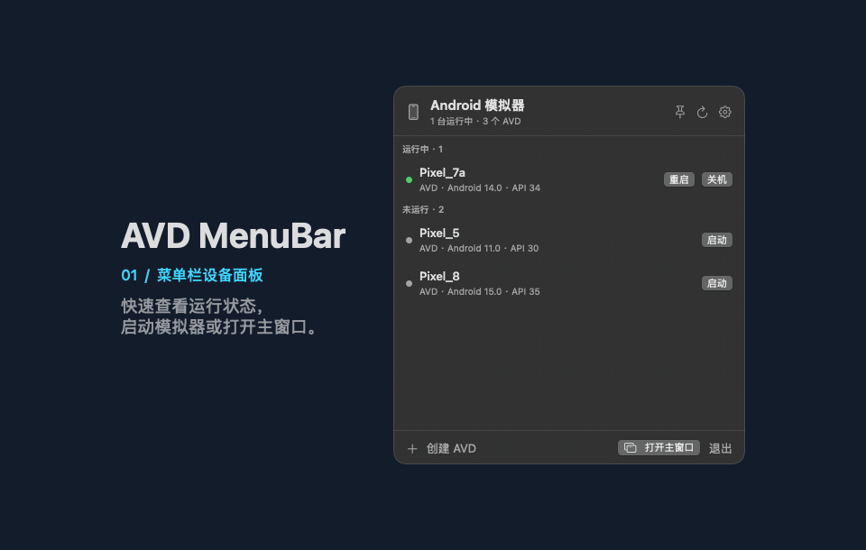

# AVD MenuBar

AVD MenuBar 是一个原生 macOS 菜单栏工具，可查看和管理本机 Android 虚拟设备（AVD），也可预览通过 ADB 连接的 Android 真机。点击菜单栏图标打开设备面板，再点「打开主窗口」查看设备画面和完整操作。



[环境要求](#环境要求) · [构建与运行](#构建与运行) · [设置](#设置) · [测试](#测试) · [贡献](CONTRIBUTING.md)

## 功能

- 菜单栏面板和主窗口按运行状态分组，显示设备名称、Android 版本和 API 级别。
- 菜单栏面板提供启动、重启和关机等常用操作；主窗口提供预览和完整管理操作。
- 启动、关机、软重启、冷启动、清除数据、删除、重命名
- 快照管理：保存/加载/删除命名快照（`default_boot` 内部 quickboot 不展示）
- 信息与复制：AVD 详情、复制名称/路径/启动命令、打开 AVD 目录、打开模拟器日志
- 开发工具：adb shell、logcat、截图到桌面、打开 Android Studio
- AVD 管理：创建、重命名、移动目录（通过 `avdmanager create/move`）
- 菜单栏图标显示运行中/启动中数量；右键菜单提供「退出应用」
- 主界面：左侧 AVD 列表（可选中选择）、中间实时预览（ADB H264 实时流，VideoToolbox 硬解 ~30fps，可触摸）+ 底部系统按键（返回/桌面/任务列表/电源/音量±）、右侧全部功能（状态操作/快照/开发工具/复制/管理）
- 面板常驻置顶开关（头部图钉）：开启后不随点击面板外/切走应用自动隐藏
- 在主窗口的「管理」菜单中可置顶或取消置顶，方便查找常用 AVD。
- avdmanager / emulator / adb 路径自动探测，也可在设置中覆盖
- 登录时启动开关（默认关闭）

## 环境要求

- macOS 14 或更新版本；从源码构建需要支持 Swift 5.9 或更新版本的 Xcode 工具链。
- 管理 AVD 需要 Android SDK Command-line Tools（`avdmanager`）、Android Emulator（`emulator`）及 Platform-Tools（`adb`）。创建 AVD 前还需要安装所需的系统镜像。
- `avdmanager` 建议使用 JDK 17 或更新版本。连接 Android 真机需在设备上开启 USB 调试并确认主机授权。

## 构建与运行

```bash
./scripts/build-app.sh
open build/AVDMenuBar.app
```

产物：`build/AVDMenuBar.app`（ad-hoc 签名）。

GitHub Actions 会在推送、拉取请求或手动触发时构建 Apple Silicon 版。打开 **Actions → Build macOS app**，在成功运行的 **Artifacts** 中下载 `AVDMenuBar-macos-arm64.zip`。解压后得到 `AVDMenuBar.app`；构建产物采用 ad-hoc 签名，未公证。

推送版本标签后，构建成功会自动创建 GitHub Release。在 [Releases](https://github.com/calvingit/AVDMenuBar/releases) 下载 `AVDMenuBar-macos-arm64.dmg`，打开磁盘映像，将应用拖到 `Applications`。如需为已有标签补发 Release，在 `main` 上手动运行工作流并填写 `release_tag`。

如需长期使用或开启登录时启动，先退出旧版，再用访达将构建产物拖到「应用程序」，并从该位置启动。

App 只驻留菜单栏，不显示 Dock 图标。首次运行若被系统拦截，在「系统设置 → 隐私与安全性」中放行，或右键选择「打开」。

在「设置 → 语言」中可选跟随系统、简体中文或 English。语言切换在退出并重新打开应用后生效。macOS 系统提示和 Android 工具的原始输出使用各自的语言。

如果 Android SDK 位于外接硬盘等可移除卷（例如 `~/Library/Android/sdk` 是指向 `/Volumes/...` 的软链），首次读取时会弹出「访问可移除卷宗」权限请求，需要点「允许」，否则无法列出 AVD。也可以在「系统设置 → 隐私与安全性 → 文件与文件夹 → 可移除的卷宗」中授权。ad-hoc 重新签名后，系统可能再次要求授权。

如果新旧版本交替请求外接卷权限，请先退出 AVD MenuBar，并确认没有正在进行的调试任务，再执行 `adb kill-server` 后只启动要使用的版本。此命令会暂时断开其他工具的 ADB 连接，但不会关闭模拟器。

## 设置

菜单 →「设置…」：

- **avdmanager / emulator / adb 路径**：留空自动探测；可手动选择覆盖。显式填写但无效时会直接报错，不会静默回退。
- **测试**：实际执行 `avdmanager list avd`，显示解析到的路径、JAVA_HOME 与 AVD 列表。
- **登录时自动启动**：使用 `SMAppService`，建议把 App 放在 `/Applications` 后再开启。

自动探测顺序：

1. 设置中的覆盖值
2. `ANDROID_HOME`、`ANDROID_SDK_ROOT`
3. `~/Library/Android/sdk`
4. `PATH` 中的 `avdmanager`
5. Homebrew 的 `android-commandlinetools`

`emulator` 与 `adb` 默认从 avdmanager 所在 SDK 推导。`avdmanager` 依赖 JDK 17+，GUI 启动的 App 不继承 shell 的 `JAVA_HOME`，因此会依次尝试：环境变量、`/usr/libexec/java_home`、Android Studio 内置 JBR、`/Library/Java/JavaVirtualMachines`；优先选择 17+ 的 JDK。若机器上只有旧 JDK，仍会选中它，由 avdmanager 报出版本错误（错误信息会包含 stdout 提示）。

## 行为说明

- **关机**：`adb -s <serial> emu kill`；若 adb 控制台不可用，按命令行匹配进程后发送 `SIGTERM`，最后才 `SIGKILL`。
- **软重启**：`adb reboot`，Android 层重启，模拟器进程不退出。
- **冷启动**：结束进程后带 `-no-snapshot-load` 重新启动，不加载快照。
- **清除数据**：结束进程后先把 `snapshots` 目录改名归档为 `snapshots.pre-wipe-<时间>`（文件保留、不再被加载），再删除 `userdata-qemu.img`、`userdata-qemu.img.qcow2`、`userdata.img.qcow2`、`cache.img`、`cache.img.qcow2`，最后带 `-no-snapshot-load` 冷启动。保留 `userdata.img`、encryptionkey。这里不使用 `emulator -wipe-data`，因为该选项会直接删除 snapshots。
- 删除与清除数据每次都会二次确认，确认框默认按钮是「取消」。
- 运行状态每 3 秒刷新；实例启动或未完成 boot 期间改为 1 秒轮询；面板通过 `ObservableObject` 实时更新。
- 主界面预览（模拟器与真机通用）：优先走 **ADB H264 实时流**（`adb exec-out screenrecord --output-format=h264 -`，VideoToolbox 硬解 ~30fps，低延迟，无需任何系统权限）；Android screenrecord 有约 3 分钟时长上限，到达后自动重连。降级链：ADB 流快速失败连续 2 次（设备不支持 screenrecord）→ `adb exec-out screencap` 截屏轮播（约 1.5 秒/帧）。真机已实测：H264 帧即设备分辨率，触摸 1:1。
- 预览可触摸：点击=tap、拖拽=swipe、长按=long press，坐标按帧宽高比自动裁掉窗口标题栏后映射到设备分辨率（`wm size`）。ADB 流的帧即设备分辨率，映射 1:1。
- 主窗口关闭（红点）后预览捕获/轮播停止；通过面板右下角「主界面」按钮重新打开。
- 启动行为：启动时只显示菜单栏图标；主界面通过面板右下角「主界面」按钮打开。
- 快照：只展示命名快照，`default_boot` 不出现在管理列表。保存和加载需要运行中的模拟器。删除快照时，运行中的实例通过 ADB 控制台处理；如果检测到进程仍在运行但无法取得 ADB 序列号，须先关机。停止的实例直接删除对应快照目录。
- 面板行只保留常用操作（未运行「启动」，运行中「重启」「关机」）；其余功能全部在主界面右侧功能列表中。
- 置顶数据存 UserDefaults（`pinnedAVDs` / `panelPinned`）；删除或重命名 AVD 会自动同步置顶记录。

## 日志

模拟器进程的标准输出/错误写入：

```
~/Library/Logs/AVDMenuBar/<AVD 名>.log
```

模拟器意外退出时菜单会弹出退出码和日志尾部。

## 已知限制

- AVD 列表在启动、手动刷新、创建/删除/重命名/移动后重新读取（`avdmanager` 约 1 秒），运行状态独立轮询；面板通过 `ObservableObject` 实时更新。
- 创建 AVD 依赖本机已安装的 system image 和 `avdmanager list device` 的设备定义，只使用默认 `~/.android/avd` 目录。
- 「移动 AVD 目录」选择父目录，实际移动到 `<父目录>/<AVD 名>.avd`；目标已存在时拒绝执行。
- adb shell / logcat 通过生成 `.command` 脚本交给系统 Terminal 打开；截图保存到桌面。需要实例已启动。
- 清数据会把旧 `snapshots` 目录改名归档为 `snapshots.pre-wipe-<时间>`，不会删除；需要恢复旧快照时手动改回原名。归档目录会占用磁盘，可自行清理。
- 非沙盒、ad-hoc 签名，仅本机自用。登录项依赖 `SMAppService`，建议先把 App 放到 `/Applications`；注册失败时设置窗口会显示系统错误。

## 测试

```bash
swift test --skip IntegrationTests

# 用假 emulator/adb/avdmanager 脚本验证启动、停止、清数据、重启、快照、创建/重命名/移动与命令参数
AVD_MOCK_E2E=1 swift test --filter MockE2ETests
```

不带过滤参数的 `swift test` 可能连接本机 Android 设备并启动录屏。真实 SDK 和设备的验证方式见 [贡献指南](CONTRIBUTING.md#本地开发)。

## 项目文档

- [开发约定](AGENTS.md)
- [设计决策](DECISIONS.md)
- [变更记录](CHANGELOG.md)
- [安全问题报告](SECURITY.md)

## 许可证

计划采用 MIT 许可证。版权主体待确认，正式许可证尚未添加。
