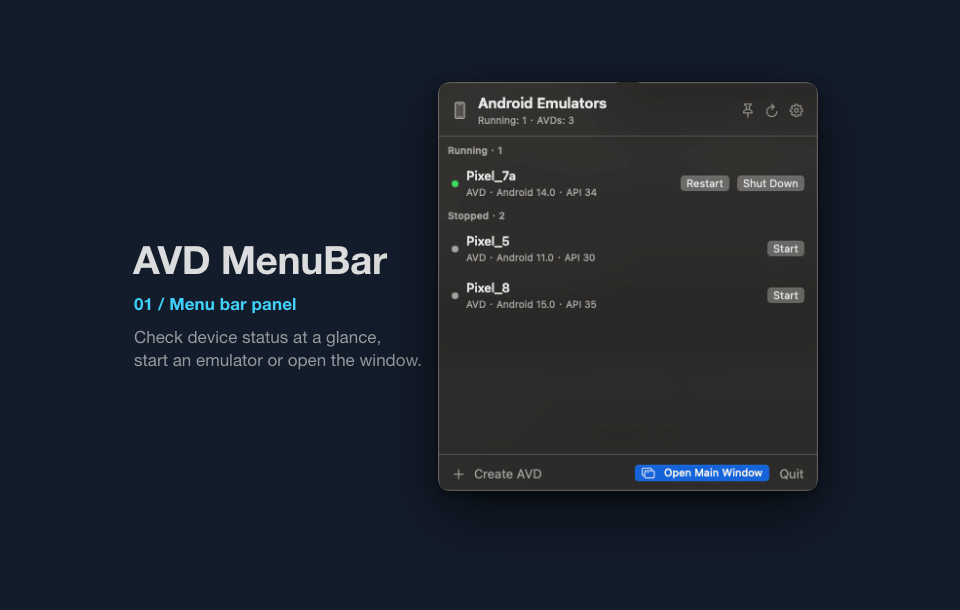

# AVD MenuBar

English | [简体中文](README_zh.md)

A native macOS menu bar app for managing local Android Virtual Devices (AVDs) and previewing Android devices connected over ADB.



[Requirements](#requirements) · [Build and run](#build-and-run) · [Contributing](CONTRIBUTING.md)

## Features

- Devices grouped by running state, with Android version and API level.
- Start, shut down, restart, cold boot, wipe data, delete, and rename AVDs.
- Live preview with touch input and Back/Home/Recents/Power/Volume buttons.
- Named snapshots: save, load, and delete.
- Copy device details or launch commands; open the AVD folder or emulator log.
- Developer tools: adb shell, logcat, screenshot, Android Studio.
- Create, rename, and move AVDs.
- Pin the panel or frequently used AVDs; optional launch at login.

## iOS Simulator support

With full Xcode (or the Command Line Tools) installed, the app also manages iOS simulators in the same panel and main window as Android devices.

- **Basic tier** (always available with Xcode): list, boot, shut down, restart, create (device types filtered by the selected iOS version), rename, delete, and erase with confirmation dialogs; screenshot polling preview; screenshots; app management (install a .app bundle, launch/terminate by bundle id, open URL); and simulator logs in a terminal (`xcrun simctl spawn <udid> log stream`).
- **Enhanced tier** (requires bundled baguette; macOS 15+ on Apple Silicon): live H.264 preview, touch/swipe/two-finger gestures, and Home/Lock/Volume keys. When the stream is unavailable, the preview automatically falls back to screenshot polling.

### Bundling baguette (optional)

`scripts/build-app.sh` embeds baguette when `Vendor/baguette/` is present:

1. Download `baguette_v0.2.13_macOS_arm64.tar.gz` from the [baguette v0.2.13 release](https://github.com/tddworks/baguette/releases/tag/v0.2.13).
2. Verify the checksum:

   ```bash
   shasum -a 256 baguette_v0.2.13_macOS_arm64.tar.gz
   # 9082478a8e6748fd46123533f004c41c815d97e087242f7dab55b6a5be758b38
   ```

3. Extract the archive and put `Baguette` and `Baguette_Baguette.bundle` into `Vendor/baguette/`.
4. Run `./scripts/build-app.sh`; the binary and its bundle are copied to `AVDMenuBar.app/Contents/Resources/Helpers/` and ad-hoc signed.

Without `Vendor/baguette/` the build prints a notice and ships the basic tier only. The baguette binary is not committed to this repository. You can also point the app at an external copy in Settings → iOS Simulators.

## Requirements

- macOS 14 or later.
- Android SDK Command-line Tools, Android Emulator, and Platform-Tools.
- JDK 17 or later for `avdmanager`.

## Build and run

```bash
./scripts/build-app.sh
open build/AVDMenuBar.app
```

The build is ad-hoc signed. GitHub Actions builds the Apple Silicon version for every push and publishes a DMG for version tags; see [Releases](https://github.com/calvingit/AVDMenuBar/releases).

On first launch, macOS may ask for access to the Android SDK or removable volumes. Grant it to list and manage AVDs. The app runs in the menu bar only.

## Settings

- **Tool paths**: detected automatically, or choose avdmanager / emulator / adb manually.
- **Language**: System, Simplified Chinese, or English; restart to apply.
- **Appearance**: System, Light, or Dark.
- **Launch at Login**.

## Notes

- Deleting an AVD and wiping its data both require confirmation.
- Wiping data keeps the old snapshots as `snapshots.pre-wipe-<time>`.
- The preview uses an ADB video stream and falls back to screenshots when the stream is unavailable.
- Only named snapshots are listed; saving and loading require a running emulator.
- Emulator logs are written to `~/Library/Logs/AVDMenuBar/<AVD name>.log`.

## Project docs

- [Development guidelines](AGENTS.md)
- [Contributing](CONTRIBUTING.md)
- [Changelog](CHANGELOG.md)
- [Security reports](SECURITY.md)

## License

MIT is planned. The copyright holder is still being confirmed, and no license file has been added yet.
