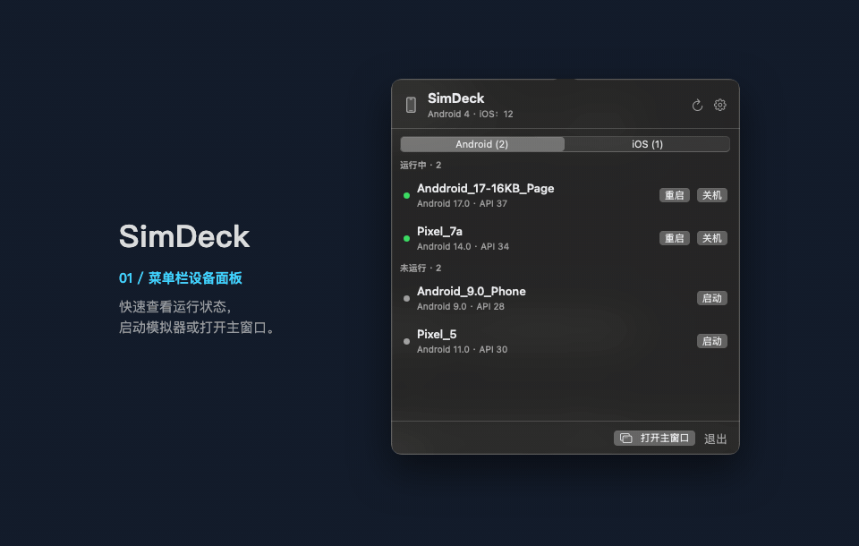

# AVD MenuBar

[English](README.md) | 简体中文

一个原生 macOS 菜单栏工具，用于管理本机 Android 虚拟设备（AVD），也可预览通过 ADB 连接的 Android 设备。



[环境要求](#环境要求) · [构建与运行](#构建与运行) · [贡献](CONTRIBUTING.md)

## 功能

- 设备按运行状态分组，显示 Android 版本与 API 级别。
- 启动、关机、重启、冷启动、清除数据、删除、重命名。
- 实时预览，支持触摸和返回/桌面/任务列表/电源/音量按键。
- 命名快照：保存、加载、删除。
- 复制设备信息或启动命令，打开 AVD 目录或模拟器日志。
- 开发工具：adb shell、logcat、截图、Android Studio。
- 创建、重命名、移动 AVD。
- 面板与常用 AVD 可置顶；可选登录时启动。

## iOS 模拟器支持

安装了完整 Xcode（或 Command Line Tools）时，应用会同时管理 iOS 模拟器，与 Android 设备共用面板和主窗口。

- **基础档**（有 Xcode 即可用）：列表、启动、关机、重启、创建（机型随所选 iOS 版本过滤）、重命名、删除、抹掉（均有确认弹窗）；截图轮询预览；截图保存；App 管理（安装 .app 包、按 bundle id 启动/终止、打开 URL）；在终端打开模拟器日志（`xcrun simctl spawn <udid> log stream`）。
- **增强档**（需内嵌 baguette；macOS 15+ 且 Apple Silicon）：实时 H.264 预览、触摸/滑动/双指手势、Home/Lock/音量按键；串流不可用时自动降级为截图轮询。

### 内嵌 baguette（可选）

存在 `Vendor/baguette/` 时，`scripts/build-app.sh` 会把它内嵌进产物：

1. 从 [baguette v0.2.13 release](https://github.com/tddworks/baguette/releases/tag/v0.2.13) 下载 `baguette_v0.2.13_macOS_arm64.tar.gz`。
2. 核对校验和：

   ```bash
   shasum -a 256 baguette_v0.2.13_macOS_arm64.tar.gz
   # 9082478a8e6748fd46123533f004c41c815d97e087242f7dab55b6a5be758b38
   ```

3. 解压，把 `Baguette` 与 `Baguette_Baguette.bundle` 放入 `Vendor/baguette/`。
4. 运行 `./scripts/build-app.sh`；二进制与资源包会拷贝到 `AVDMenuBar.app/Contents/Resources/Helpers/` 并 ad-hoc 签名。

缺少 `Vendor/baguette/` 时构建打印提示并跳过，产物只含基础档。baguette 二进制不入库；也可以在「设置 → iOS 模拟器」中把 baguette 指向外部副本。

## 环境要求

- macOS 14 或更新版本。
- Android SDK Command-line Tools、Android Emulator 和 Platform-Tools。
- `avdmanager` 需要 JDK 17 或更新版本。

## 构建与运行

```bash
./scripts/build-app.sh
open build/AVDMenuBar.app
```

产物为 ad-hoc 签名的 `build/AVDMenuBar.app`。GitHub Actions 会为每次推送构建 Apple Silicon 版本，推送版本标签时发布 DMG，见 [Releases](https://github.com/calvingit/AVDMenuBar/releases)。

首次启动时，macOS 可能请求访问 Android SDK 或可移除卷宗；授权后才能读取和操作 AVD。应用只驻留菜单栏。

## 设置

- **工具路径**：自动探测，也可手动指定 avdmanager / emulator / adb。
- **语言**：跟随系统、简体中文或 English，重开应用后生效。
- **外观**：跟随系统、浅色或深色。
- **登录时自动启动**。

## 说明

- 删除 AVD 和清除数据都会二次确认。
- 清除数据会把旧快照保留为 `snapshots.pre-wipe-<时间>`。
- 预览使用 ADB 视频流；视频流不可用时自动降级为截屏。
- 只展示命名快照；保存和加载需要模拟器处于运行状态。
- 模拟器日志位于 `~/Library/Logs/AVDMenuBar/<AVD 名>.log`。

## 项目文档

- [开发约定](AGENTS.md)
- [贡献指南](CONTRIBUTING.md)
- [变更记录](CHANGELOG.md)
- [安全问题报告](SECURITY.md)

## 许可证

计划采用 MIT 许可证。版权主体待确认，正式许可证尚未添加。
